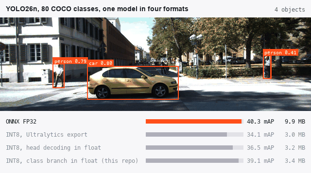
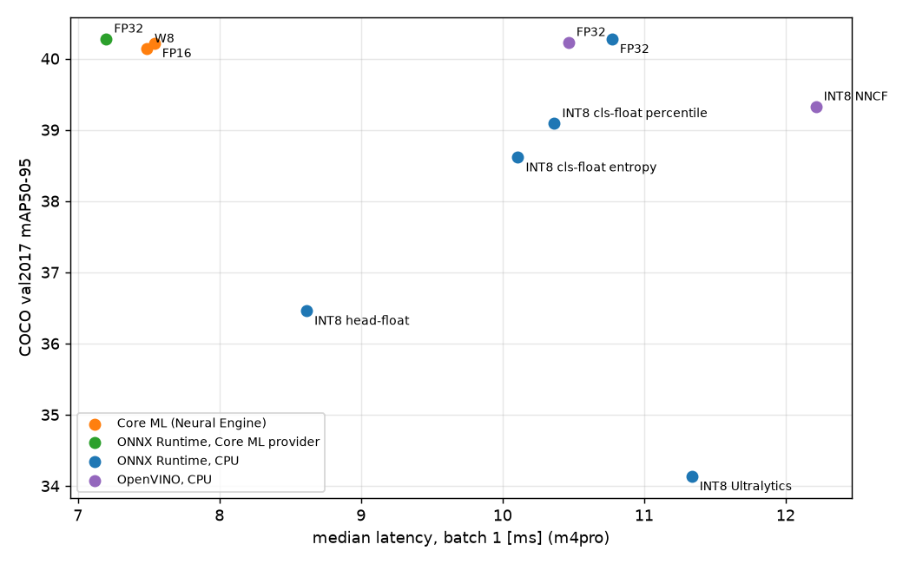

# Edge optimisation of YOLO26

How small and how fast can a detector get before it stops being accurate? YOLO26n, the
smallest NMS-free YOLO, exported to every runtime it targets (ONNX Runtime, OpenVINO, Core ML,
TensorRT), quantised to INT8 in several ways and measured on the full COCO val2017 set with the
official metric, next to the latency on an Apple M4 Pro. The INT8 work is my own: post-training
quantisation with ONNX Runtime, a layer-sensitivity analysis that finds what must stay in float,
and a comparison of calibration methods; quantisation-aware training and TensorRT run on a GPU cluster.

<p align="center"></p>
<sub>One model, four exports, the same KITTI street photo. Where the quantisation is placed decides
how much of the float model's accuracy survives at a third of the size.</sub>



## Highlights

- **Quantise the network, keep the head's decoding in float.** YOLO26's end-to-end head ends
  by concatenating box coordinates in pixels (0-640) with class probabilities (0-1) into one
  tensor before its top-k selection; a single INT8 scale cannot hold both ranges. Those few
  cheap nodes stay in float, so the INT8 model keeps 97 % of the float accuracy. A unit test
  checks the rule on a six-node graph.
- **Layer sensitivity analysis.** Every block of the network, and the head's box and class
  branches, is kept in float in turn while the rest is INT8, and scored on 500 val images. One
  group stands out: the class branch of the head (+2.1 mAP when kept in float); no other block
  is worth more than 1.2, and keeping more blocks in float together adds nothing.
- **Calibration matters as much as the graph.** With the class branch in float, percentile
  calibration (99.999th) loses 1.2 points against float, entropy 1.7, min-max 2.3. Ranges from
  histograms are collected in chunks: ONNX Runtime otherwise keeps every activation of every
  calibration image in memory, and the process died on 512 images at 640 px.
- **Five points better than the standard export.** Ultralytics' own INT8 ONNX export
  (`quantize=8`) quantises only convolutions with one weight scale per tensor and min-max ranges:
  34.1 mAP. Per-channel weight scales, the class branch in float and percentile calibration
  give 39.1, for 0.4 MB more.
- **On Apple silicon, INT8 buys size, not CPU speed.** ONNX Runtime's INT8 kernels are slower
  than its FP32 path on one M4 core and only catch up with more threads; the Neural Engine
  runs the FP16 Core ML model in 7.5 ms, faster than any CPU variant. INT8 pays off on x86 CPUs
  with VNNI and on TensorRT, which the cluster jobs measure.

## Results

COCO val2017, all 5000 images, official COCO evaluation (faster-coco-eval on the saved
predictions), 640 px, NMS-free head (`nms=False`) unless noted:

| Variant | Size | mAP50-95 | vs. ONNX FP32 | Ultralytics docs |
|---|---|---|---|---|
| PyTorch FP32, one-to-many head + NMS | 5.5 MB | 40.8 | +0.5 | 40.9 |
| ONNX FP32, end-to-end | 9.9 MB | **40.3** | 0.0 | 40.1 |
| OpenVINO FP32 | 10.1 MB | 40.2 | 0.0 | |
| Core ML FP16 | 5.1 MB | 40.2 | -0.1 | |
| Core ML, 8-bit palettised weights | 2.7 MB | 40.1 | -0.1 | |
| OpenVINO INT8 (NNCF, head and sigmoids in float) | 3.4 MB | 39.3 | -1.0 | |
| **ONNX INT8, class branch in float, percentile** (this repo) | 3.4 MB | **39.1** | -1.2 | |
| ONNX INT8, class branch in float, entropy | 3.4 MB | 38.6 | -1.7 | |
| ONNX INT8, class branch in float, min-max | 3.4 MB | 37.9 | -2.3 | |
| ONNX INT8, head decoding in float only, min-max | 3.2 MB | 36.5 | -3.8 | |
| ONNX INT8, Ultralytics export (`quantize=8`) | 3.0 MB | 34.1 | -6.1 | |
| ONNX INT8, everything quantised | 3.1 MB | 0.0 (500 images) | | |

The float exports reproduce the documentation (40.3 against 40.1 for the end-to-end head;
40.8 against 40.9 with NMS). All INT8 variants are calibrated on 512 images from train2017,
never on val.

**Latency** on an Apple M4 Pro (median of 200 calls, batch 1, model only, ms):

| Variant | ORT CPU 1 thread | ORT CPU 4 threads | ORT CPU 8 threads | OpenVINO CPU, 8 threads | Neural Engine |
|---|---|---|---|---|---|
| FP32 / FP16 | 19.9 | 12.0 | 10.8 | 10.5 | 7.5 (Core ML FP16), 7.2 (ORT Core ML provider) |
| INT8, class branch in float, percentile | 27.7 | 12.2 | 10.4 | | |
| INT8, head decoding in float | 26.3 | 11.6 | 8.6 | | |
| INT8, Ultralytics export | 33.5 | 14.8 | 11.3 | | |
| INT8, OpenVINO NNCF | | | | 12.2 | |
| 8-bit weights (Core ML) | | | | | 7.5 |

The quantised models are a third of the size, which matters for download and memory on a
device, but on this ARM CPU ONNX Runtime's INT8 path pays for the quantise/dequantise steps
around every operator that stays in float. OpenVINO's ARM plugin is the slowest on one thread
(45 ms FP32, 60 ms INT8).

**Sensitivity analysis** (first 500 val images; float 41.9, all-INT8 with float head decoding 37.9):

| Kept in float | mAP50-95 recovered |
|---|---|
| head, class branch (`one2one_cv3`) | +2.1 |
| block 2 (C3k2) | +1.2 |
| block 4 (C3k2) | +1.1 |
| block 0 (stem) | +0.6 |
| head, box branch (`one2one_cv2`) | +0.4 |
| class branch + blocks 2 and 4 together | +2.0 |

**On NVIDIA GPUs and x86 CPUs** (COCO val2017, all 5000 images; the same exports, plus
TensorRT engines and 10 epochs of quantisation-aware training, both run on a GPU cluster):

| Variant | YOLO26n mAP50-95 | YOLO26s mAP50-95 |
|---|---|---|
| ONNX FP32 | 40.3 | 47.7 |
| TensorRT FP16 | 40.3 | 47.7 |
| **ONNX INT8, class branch in float, percentile** (this repo) | **39.1** | **46.5** |
| OpenVINO INT8 (NNCF) | 39.4 | 46.3 |
| INT8 after quantisation-aware training, 10 epochs (TensorRT) | 38.3 | 45.7 |
| TensorRT INT8 (ModelOpt calibration) | 37.1 | 45.1 |
| ONNX INT8, Ultralytics export | 34.0 | 37.0 |

| Median latency, batch 1, ms | YOLO26n | YOLO26s |
|---|---|---|
| A100, TensorRT FP16 | 2.0 | 2.2 |
| A100, TensorRT INT8 | 1.9 | 2.0 |
| x86 CPU, 8 threads, OpenVINO FP32 | 9.8 | 23.7 |
| x86 CPU, 8 threads, OpenVINO INT8 | **5.9** | **10.7** |

- **Careful post-training quantisation is as good as quantisation-aware training.** Keeping the
  head's class branch in float with percentile calibration reaches 39.1 and 46.5 mAP, ahead of
  ten epochs of QAT on all of COCO (38.3 and 45.7), with no training at all.
- **INT8 pays off on x86 with OpenVINO:** 1.7x faster than FP32 for YOLO26n and 2.2x for
  YOLO26s, at 0.9 to 1.5 points of mAP.
- **On a data-centre GPU, FP16 is already enough.** TensorRT runs either model in about 2 ms at
  batch 1; INT8 saves a tenth of a millisecond, because the GPU is far from busy at this size.

## Quickstart

```bash
pip install -e ".[mac,dev]"                 # or ".[cuda]" on Linux with an NVIDIA GPU
bash scripts/download_data.sh --small        # COCO val2017 + 1024 calibration images, YOLO26n/s
edge-export --weights runs/models/yolo26n.pt --data data/coco/coco.yaml --out runs/models \
    --variants onnx ul-int8 openvino openvino-int8 coreml coreml-int8
edge-quantize --model runs/models/yolo26n_fp32.onnx --calib data/coco/calib2017.txt \
    --exclude head-postprocess --float-groups 23/one2one_cv3 --method percentile \
    --out runs/models/yolo26n_int8-cls-float-percentile.onnx
edge-sensitivity --model runs/models/yolo26n_fp32.onnx --data data/coco/coco.yaml \
    --calib data/coco/calib2017.txt --images 500 --out runs/sensitivity/yolo26n
edge-eval --models runs/models/yolo26n_*.onnx --data data/coco/coco.yaml --out runs/accuracy
edge-latency --runtime ort-cpu --threads 1 4 8 --models runs/models/yolo26n_*.onnx
edge-summary --accuracy runs/accuracy --latency runs/latency --sensitivity runs/sensitivity --out runs/summary
```

`edge-data` downloads val2017 and reads 1024 calibration images out of the 19 GB train2017
archive with HTTP range requests: its members are stored in random order, so 16 runs of 64
consecutive members are a random sample that arrives in a few requests.

## Running on a Slurm cluster

```bash
bash scripts/setup_cluster.sh && bash scripts/download_data.sh          # login node; --full train2017 for QAT
python3 slurm/generate.py export --submit          # ONNX, OpenVINO, TensorRT FP16/INT8 for n and s (A100)
python3 slurm/generate.py ptq --submit             # ONNX Runtime INT8 variants (CPU)
python3 slurm/generate.py sensitivity --submit
python3 slurm/generate.py qat --submit             # 10 epochs, Ultralytics + ModelOpt
python3 slurm/generate.py qat-float-control --submit
python3 slurm/generate.py export-qat --submit      # Q/DQ ONNX and TensorRT INT8 from the QAT weights
python3 slurm/generate.py accuracy --submit && python3 slurm/generate.py accuracy-gpu --submit
python3 slurm/generate.py latency-cpu --submit && python3 slurm/generate.py latency-gpu --submit
python3 slurm/generate.py summary --submit
```

TensorRT engines are built on the GPU type they will run on, so export and timing request the
same node type (`constraint = "a100"`).

## Project layout

```
src/edge_opt/
  data.py           COCO val2017 + calibration subset (range requests), dataset YAML
  export.py         Ultralytics export to every format, named by precision, NMS-free head
  quantize.py       ONNX Runtime static INT8 (QDQ, per-channel), exclusion rules, chunked calibration
  sensitivity.py    leave-one-group-out analysis, top-k mixed precision
  qat.py            quantisation-aware training and its float control (Ultralytics + ModelOpt)
  evaluate.py       accuracy of any format; official COCO AP from the saved predictions
  latency.py        ONNX Runtime (CPU, Core ML, CUDA, TensorRT providers), OpenVINO, Core ML, TensorRT
  summary.py        tables and the accuracy-latency plot
tests/              the INT8 head failure in miniature, grouping, letterbox, calibration sampling, tables
```

## Design notes

- **Why the end-to-end head?** YOLO26's one-to-one head returns at most 300 boxes without NMS.
  An edge pipeline then has no NMS to port, and the latency of the network is the latency of
  the detector. The price is 0.8 mAP against the one-to-many head with NMS (40.1 vs 40.9 in the
  documentation, 40.3 vs 40.8 here).
- **Per-channel weights.** Convolution filters differ by orders of magnitude in range; one
  scale per output channel costs nothing at inference and is supported by every INT8 runtime
  used here.
- **Asymmetric activations, symmetric weights.** ONNX Runtime's default: activations after
  SiLU are mostly positive, and an asymmetric range does not waste half of the 256 levels on
  negative values. TensorRT accepts only symmetric scales, which is why its INT8 rows use
  ModelOpt's explicit quantisation instead of these files.
- **Model call only.** Preprocessing and decoding are the same for every variant and depend
  on the camera pipeline, so they are not timed. The input is a real image, not zeros.
- **Background jobs on macOS.** zsh starts background jobs with a lower priority (`BG_NICE`),
  and macOS then schedules a single-threaded process on the efficiency cores: the first latency
  run measured ONNX FP32 at 29 ms instead of 20 ms. The benchmarks run at normal priority.

## References

- Ultralytics YOLO26: https://docs.ultralytics.com/models/yolo26/ (COCO mAP, end-to-end head).
- B. Jacob et al., *Quantization and Training of Neural Networks for Efficient Integer-Arithmetic-Only Inference*, CVPR 2018.
- M. Nagel et al., *A White Paper on Neural Network Quantization*, arXiv:2106.08295, 2021 (per-channel weights, calibration, sensitivity).
